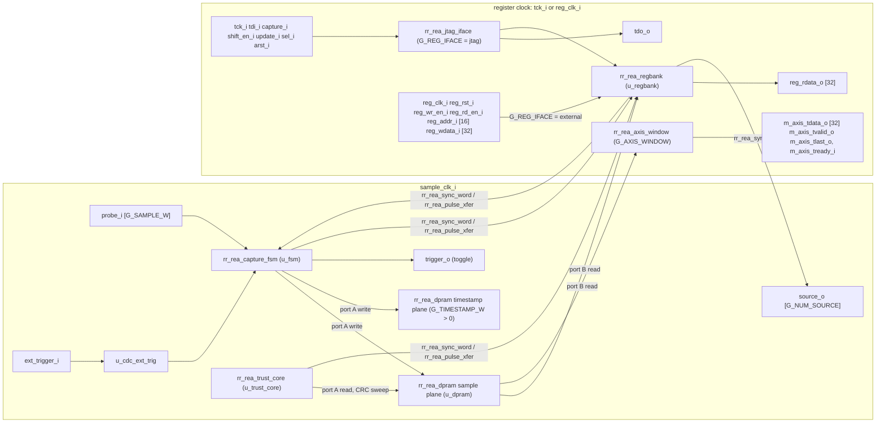

<!-- rr:fdd v1 ip=rr_rea_top -->
# rr_rea_top — Firmware Design Document

Facts verified against `d7b7d3b` on 2026-10-20.

<!-- rr:fdd:generated:begin -->
<!-- rr:fdd:inputs sha256:caae157c5229cc8a -->
<!-- rr:fdd:projection v3 -->
> Machine-owned block — scaffolded by `rr fdd init`, refreshed by
> `rr fdd generate`. Do not edit inside the markers;
> edit the canonical declarative files it references. FDD state is
> documentation completeness only — never behavioral proof.

**IP:** `rr_rea_top` v0.1

## Canonical References

- **Requirements** — `requirements.yml`: REA-REQ-200 (behavioral), REA-REQ-201 (behavioral), REA-REQ-202 (behavioral), REA-REQ-001 (behavioral), REA-REQ-002 (behavioral), REA-REQ-003 (behavioral), REA-REQ-010 (behavioral), REA-REQ-011 (behavioral), … (+115 more — see the Requirements table below)
- **Interfaces** — `requirements.yml` port_contract:
  - none declared
  - _contract_: declared here from the contract — not proof the HDL matches; verify with `rr sim contract-check`
- **Registers** — `rea_regbank.yml`
- **Dependencies** — `ip.yml` build.ips: none declared
- **Decisions** — no `decisions.yml`

## Requirements

| ID | Kind | Requirement |
|---|---|---|
| REA-REQ-200 | behavioral | Write/read same address (port A → port B) returns the same value on the next clk_b cycle (synchronous read). |
| REA-REQ-201 | behavioral | Concurrent write on port A and read on port B at DIFFERENT addresses do not collide; port B sees previously-written data. |
| REA-REQ-202 | behavioral | Generic WIDTH and DEPTH parameters drive the actual storage shape (verified by writing/reading at addr=DEPTH-1 and din=2^WIDTH-1). |
| REA-REQ-001 | behavioral | Single register write opcode produces exactly one reg_wr_en pulse with reg_addr / reg_wdata carrying the values shifted in via tdi. |
| REA-REQ-002 | behavioral | Single register read opcode latches the addressed value and shifts it out on TDO over the next 32 shift cycles. |
| REA-REQ-003 | behavioral | N successive read scans each shift out their addressed reg_rdata via tdo without losing or aliasing values — the prerequisite for the host's read_block USER1 fallback path. |
| REA-REQ-010 | behavioral | Every RW register address except DECIM (0x00B0, 24-bit applied ratio, REA-REQ-971) round-trips an arbitrary 32-bit value (write then read returns the same value). The register bank SHALL also elaborate without inferred latches in the GHDL-to-Yosys synthesis flow; disabled optional register banks receive an explicit clock-edge assignment. |
| REA-REQ-011 | behavioral | STATUS register reflects its input wires (armed, triggered, done, overflow) combinationally. |
| REA-REQ-012 | negative | Write to a RO address is a no-op (no aliasing into a RW slot at the same low-order bits). |
| REA-REQ-013 | behavioral | Wide trigger value/mask (G_SAMPLE_W > 32) are banked into ceil(G_SAMPLE_W/32) 32-bit words paged via TRIG_WORD_SEL (0x2C): with sel=k, a write/read of TRIG_VALUE/TRIG_MASK (0x24/0x28) targets word k, and the full value drives trig_value_out/ trig_mask_out. sel resets to 0, so a G_SAMPLE_W<=32 core (or a host that never writes TRIG_WORD_SEL) is byte-identical to the legacy single-word path (RTL-P2.658). |
| REA-REQ-014 | behavioral | Wide capture data (G_SAMPLE_W > 32) is exposed through the frozen one-address-per-cell DATA_BASE window, paged independently by DATA_WORD_SEL (0xCC). Selector k returns sample bits [32*k+31:32*k], zero-padding a partial final word and returning zero for an out-of-range selector. The selector resets to 0, preserving byte-identical low-word readback for hosts that never write it. |
| REA-REQ-015 | behavioral | Identity/content fingerprint registers (RTL-P3.1198). FEATURES (0xD0, RO) packs the synth-time generics into a config fingerprint: bits[7:0] = G_TRIG_CONDS, bits[15:8] = G_NUM_SOURCE, bit[16] = '1' when G_SAMPLE_W > 32, bit[17] = wide-condition decode, and bit[18] = '1' when G_TIMESTAMP_W > 0. BUILD_ID (0xD4, RO) reads back the G_BUILD_ID generic verbatim (default 0 = not injected). Both are read-only: a write must not change them and must not alias into a RW slot. |
| REA-REQ-019 | behavioral | VERSION (0x00, RO) SHALL read the exact current feature-tier magic 0x5245410F (v0.15, REA-P3.7 sequencer register window; v0.13 added TRIG_LATENCY, v0.11 storage qualification). The value is a protocol discriminator, not an inferred string or a mutable register. The tier byte is ODD by permanent contract (REA-REQ-806) — the one-read odd-VERSION probe is how a wide-readback miscompile is detected (RTL-P1.96). |
| REA-REQ-022 | behavioral | CAPTURE_LEN (0x1C, RO) SHALL update combinationally from the current PRETRIG and POSTTRIG register values as PRETRIG + POSTTRIG + 1 using 32-bit unsigned arithmetic; it does not require an arm or completed capture before reporting the configured window length. |
| REA-REQ-023 | behavioral | TIMESTAMP_W (0xC4, RO) SHALL report the exact G_TIMESTAMP_W synth-time generic. In v0.7 FEATURES[18] SHALL be set exactly when TIMESTAMP_W is nonzero; zero SHALL elaborate no timestamp storage plane. |
| REA-REQ-024 | behavioral | When G_TIMESTAMP_W > 0, each stored sample SHALL have a same-address, same-write-enable timestamp from a free-running sample-clock counter. DATA_PLANE_SEL=1 and DATA_WORD_SEL SHALL expose the full timestamp through DATA_BASE. Sample and timestamp readback SHALL remain aligned after the same START_PTR rotation across ring wrap and trigger. |
| REA-REQ-016 | behavioral | Sample-width ceiling C_MAX_SAMPLE_W is 1024 bits (RTL-P2.876). A probe up to the ceiling (e.g. the field's 704-bit build) SHALL elaborate and the banked trigger value/mask SHALL page into ceil(G_SAMPLE_W/32) 32-bit words via TRIG_WORD_SEL, reassembling into the full-width `trig_value_out` — storage sized by the INSTANTIATED width, not the ceiling. The wide-sample FEATURES fingerprint stays set for any G_SAMPLE_W>32. Wide sample and comparator data/config registers SHALL be excluded from the asynchronous sample reset tree and qualified by resettable valid/enable control state, so reset-recovery fanout does not scale with G_SAMPLE_W (RTL-P2.897). |
| REA-REQ-017 | behavioral | Wide comparator conditions (RTL-P2.876). COND_CFG carries an 11-bit field_lsb {lsb_hi[30:28], lsb_lo[15:8]} (0..2047) so a per-condition comparator field can sit above bit 255. The regbank SHALL expand a slot with field_lsb>=256 into a full-width `cond_masks_out`/`cond_values_out` shifted to that offset, and the capture FSM SHALL assert `triggered` on a masked-field match at that high offset. The wide_cond FEATURES bit SHALL be '1' exactly when G_SAMPLE_W>256, advertising the extended decode; a field_lsb<256 stays byte-identical (lsb_hi=0). |
| REA-REQ-018 | negative | Un-ignorable over-ceiling guard (RTL-P2.895). A G_SAMPLE_W > C_MAX_SAMPLE_W instantiation SHALL fail ELABORATION in every tool via a static range violation (a `natural range 0 to 0` constant assigned boolean'pos of the over-ceiling test), not merely a runtime `assert severity failure` that vendor synthesis downgrades to a warning (the mechanism that shipped undefined out-of-ceiling silicon). The friendly assert also remains for a readable message. In-ceiling widths SHALL elaborate cleanly. |
| REA-REQ-020 | behavioral | Slow-changing config word toggled mid-cycle on the source clock settles on the destination clock within ≤2 dest-clock cycles with no metastable glitch. |
| REA-REQ-021 | behavioral | Toggle-pulse-encoded src_pulse event of N src_clk cycles produces exactly one dst_pulse on dst_clk. |
| REA-REQ-100 | behavioral | wr_ptr advances every sample_clk cycle from reset deassertion, with armed=0. Sliding-window contract. |
| REA-REQ-101 | negative | arm_pulse does NOT reset wr_ptr; the buffer's pre-arm context is preserved across arm. Pins the architectural fix vs the reference ELA. |
| REA-REQ-102 | behavioral | When triggered asserts, trig_ptr_out captures wr_ptr_out at that same cycle (no off-by-N). |
| REA-REQ-103 | behavioral | dpram_addr at the cycle dpram_we is high carries the trigger sample value (probe_in & trig_mask) == (trig_value & trig_mask). |
| REA-REQ-104 | behavioral | When done asserts, start_ptr_out == (trig_ptr_out - pretrig) mod DEPTH. |
| REA-REQ-105 | behavioral | Reading DEPTH samples (snooped via dpram_we / dpram_addr / dpram_din) starting at start_ptr_out yields a time-monotonic sequence with no gaps. |
| REA-REQ-106 | negative | When the design has been running ≥ DEPTH cycles before arm, the captured window contains zero uninit-BRAM cells (no phantom zeros). |
| REA-REQ-107 | behavioral | On arm_pulse, overflow SHALL assert exactly when PRETRIG + max(POSTTRIG, TRIG_LATENCY) is greater than or equal to DEPTH, and SHALL clear for a subsequent legal arm or reset_pulse. The TRIG_LATENCY samples stored while the trigger pipeline catches up land past the trigger cell whatever POSTTRIG says, so a capture spans PRETRIG + max(POSTTRIG, TRIG_LATENCY) + 1 ring cells; a larger request would overwrite its own oldest pre-trigger cells (REA-T2.6). Below the bound every cell of the window SHALL be this capture's. STATUS[3] mirrors this generated FSM flag through the sample-to-JTAG CDC. |
| REA-REQ-108 | behavioral | While armed and not yet triggered, the trigger condition SHALL be evaluated on EVERY stored sample, not only at or near arm_pulse. A condition that is FALSE at arm and becomes true later — the whole reason a pre-trigger window exists — SHALL fire the capture, including when the condition is a probe bit driven by a host SOURCE write during the armed window, and regardless of whether any JTAG traffic occurs while armed. Until the capture fires it SHALL remain untriggered for the entire interval the condition is false. RTL-T2.220: REA-REQ-100..107 pin the sliding window and the pointer arithmetic — the output mapping — so a core that only sampled the condition at arm satisfied every one of them, and the shipped rea_source_demo documented a pre-trigger scenario that nothing had ever shown the hardware perform. |
| REA-REQ-400 | behavioral | An external trigger_in pulse on sample_clk fires the capture exactly like a local trigger_hit — triggered_r asserts and trig_ptr_r captures wr_ptr_r at the same cycle. |
| REA-REQ-401 | negative | An external trigger_in pulse must NOT drive trigger_out_r (otherwise N coupled REA cores ping-pong forever). Only a local trigger_hit drives trigger_out_r. |
| REA-REQ-410 | behavioral | With TRIG_MODE ext_en[3]=1 and ext_and[8]=0 (OR mode), raising ext_trigger_in alone fires the capture even when the internal comparator never matches — fire on (internal hit) OR (ext pin). |
| REA-REQ-411 | behavioral | With ext_en[3]=1 and ext_and[8]=1 (AND mode), a permanently-true internal comparator must NOT fire while ext_trigger_in is low, and MUST fire once the pin rises — fire only on (internal hit) AND (pin). |
| REA-REQ-412 | negative | With ext_en[3]=0 the ext_trigger_in pin is ignored entirely — a pin held high must not fire the capture (the internal-only path is unchanged when the feature is off; back-compat). |
| REA-REQ-413 | negative | In AND mode, `trigger_out` (the trig_xbar drive) pulses only on the true local fire (comparator AND ext_trigger_in both held) — never on the comparator alone, which by itself does not fire (no premature ping-pong of coupled cores). |
| REA-REQ-402 | behavioral | A toggle on toggle_a_in produces exactly one pulse_b_out on clk_b within ≤4 dst-clock cycles, and vice versa for the reverse direction (toggle_b_in → pulse_a_out). |
| REA-REQ-500 | behavioral | With decim_ratio_in=0, dpram_we fires every cycle (matches v0.1/v0.2 — no decimation). Sliding-window contract intact. |
| REA-REQ-501 | behavioral | With decim_ratio_in=N (N>0), dpram_we asserts on exactly one cycle per (N+1) sample-clock cycles. wr_ptr advances on each asserted cycle. post_count counts STORED samples (so the post-trigger window is posttrig_len_in stored cells regardless of decimation). |
| REA-REQ-610 | behavioral | With trig_mode_in op=RISE (0x4), `triggered` fires on the cycle a masked probe_in bit transitions 0->1 relative to the previous sample (any bit under trig_mask_in). It does NOT fire on a steady-high probe held across cycles (only the transition edge fires). |
| REA-REQ-611 | behavioral | With trig_mode_in op=FALL (0x5), `triggered` fires on a masked probe_in bit transitioning 1->0. It does NOT fire on a rising edge nor on a steady-low probe. |
| REA-REQ-620 | behavioral | With trig_mode_in op=LT (0x2), `triggered` fires when the masked probe_in (unsigned) is strictly less than the masked trig_value_in. It does NOT fire on equality nor on greater-than. |
| REA-REQ-621 | behavioral | With trig_mode_in op=GT (0x3), `triggered` fires when the masked probe_in (unsigned) is strictly greater than the masked trig_value_in. It does NOT fire on equality nor on less-than. |
| REA-REQ-630 | behavioral | With trig_mode_in op=NE (0x1), `triggered` fires when the masked probe_in differs from the masked trig_value_in in ANY bit (multi-bit inequality). It does NOT fire when the masked fields are equal. |
| REA-REQ-600 | behavioral | With seq_enable_in=0 (default), the FSM honors the legacy trig_value_in / trig_mask_in comparator: a matching probe_in drives triggered identically to v0.1/v0.2 behavior. No regression on REA-REQ-100..106. |
| REA-REQ-601 | behavioral | With G_TRIG_STAGES=N and seq_enable=1, seq_state advances from K to K+1 only when stage K's local comparator (using seq_value_k, seq_mask_k, seq_mode_k against probe_in) matches. seq_state never advances on a stage-K+1 match while seq_state == K. |
| REA-REQ-602 | behavioral | The FINAL stage's local comparator match drives both triggered and trigger_out at the match cycle, then the post-trigger countdown runs unchanged. |
| REA-REQ-603 | behavioral | Each stage's seq_count_target_k, when non-zero, requires that many cumulative matches before advancing. seq_counter_k tracks the matches and resets when seq_state advances past stage K (or on arm_pulse). |
| REA-REQ-604 | negative | A non-final-stage match must NOT drive triggered or trigger_out. Only the final stage's match drives the capture trigger. |
| REA-REQ-605 | negative | An out-of-order probe_in pattern that matches a later stage's value while we're still on an earlier stage must NOT fire triggered. Only an in-order traversal advances the sequencer to the final stage. |
| REA-REQ-606 | behavioral | arm_pulse resets seq_state to 0 and clears all seq_counter_k registers. A new arm cycle restarts the sequence from stage 0 regardless of where the previous capture left it. |
| REA-REQ-607 | behavioral | Per-stage config maps at ADDR_SEQ_BASE = 0x0040 with stride 20 bytes for stages 0..G_TRIG_STAGES-1: +0 SEQ_CFG keeps count_target in [15:0] (other bits dropped, read 0); +4 SEQ_VALUE and +8 SEQ_MASK are 32-bit windows onto the full G_SAMPLE_W-bit stage value/mask, paged by TRIG_WORD_SEL like TRIG_VALUE/TRIG_MASK, and read back what was written. The reserved +0x0C/+0x10 slots and every address of a stage >= G_TRIG_STAGES drop their writes and read 0. No SEQ write aliases into the v0.1/v0.2 RW slots (PRETRIG / POSTTRIG / TRIG_VALUE / TRIG_MASK / CHAN_SEL / DECIM). TRIG_MODE bit[1] enables the sequencer and the stage config reaches rr_rea_capture_fsm through the CDC. |
| REA-REQ-608 | behavioral | Per-condition comparator array (mixed-op AND, RTL-P3.647). When array_enable_in is set, the capture FSM ANDs every VALID condition slot: slot k applies its own op through cond_ops_in / cond_ops_out to its masked field (probe_in and cond_masks_in / cond_masks_out) vs cond_values_in / cond_values_out. `triggered` fires only when ALL valid slots match; an invalid slot does not block; an all-invalid array never fires (no free-fire on arm). array_enable_in=0 leaves the legacy single-comparator path unchanged; seq_enable takes precedence over array_enable_in. |
| REA-REQ-700 | behavioral | source_out resets to all-zeros (every gated DUT signal held SAFE/inactive) and STAYS zero across a full trigger-config load, an arm pulse, and a reset pulse — nothing but an explicit SOURCE-register write releases it. Pins the no-auto-release contract: the gate must start closed so the operator can arm REA before releasing the DUT. |
| REA-REQ-701 | behavioral | A JTAG write to SOURCE (0x3C) drives the low G_NUM_SOURCE bits onto source_out in the sample_clk domain within a few sample-clocks, having crossed jtag_clk → sample_clk through rr_rea_sync_word (two-flop ASYNC_REG sync); a clearing write re-gates it, and the register round-trips on JTAG readback (release → re-gate → full-width release). |
| REA-REQ-702 | negative | Only the low G_NUM_SOURCE bits of the SOURCE register reach source_out. Bits above G_NUM_SOURCE are stored (round-trip on readback) but MUST NOT drive the port — the port width is the contract, guarding against a wide-slice bug leaking phantom control bits into the design. |
| REA-REQ-300 | behavioral | Full end-to-end with mocked BSCAN — driving tdi / capture / shift_en / update / sel through the configure → arm → wait done → read sequence the reference host uses, the dpram readback via tdo matches a known sample-clock counter pattern. |
| REA-REQ-301 | negative | rr_rea_top SHALL NOT expose G_INPUT_PIPE_STAGES. A one-cycle `probe_in` trigger value MUST NOT bypass the internally-derived comparator stages; `triggered` SHALL assert only after the derived latency. |
| REA-REQ-302 | negative | rr_rea_capture_fsm SHALL NOT expose G_TRIGGER_PIPE_STAGES. A derived local fire SHALL preserve `trig_ptr_out` and pulse `trigger_out` once; an independent `trigger_in` pulse remains immediate and MUST NOT drive `trigger_out`. |
| REA-REQ-303 | behavioral | For every legal G_SAMPLE_W, the host SHALL reconstruct each captured sample exactly by reading DATA_BASE once per DATA_WORD_SEL bank in little-endian word order, masking unused bits in the partial final word, then restoring DATA_WORD_SEL to 0. G_SAMPLE_W<=32 SHALL perform the historical single read per cell without accessing the selector. |
| REA-REQ-320 | behavioral | The local comparator pipeline stage count SHALL be internally derived, never supplied by a user-facing depth generic. C_SLICE_W is a FIXED internal constant (C_SLICE_W=8), not a generic: the compare/reduce structure (slice count, carry-chain depth, reduction fan-in) is generated against it, so exposing it would only spawn dead if-generate branches for a decision made at design time. With C_WIDTH_STAGES=ceil(G_SAMPLE_W/C_SLICE_W), C_REDUCE_STAGES=ceil_log2(G_TRIG_CONDS), and N=C_WIDTH_STAGES+C_REDUCE_STAGES. N is at least one. The implementation SHALL use exactly N registered compare/reduce stages for a local trigger decision and its sample tag. G_TRIG_STAGES does not contribute reduction depth: sequencer stages are an ordered state dependency, not a simultaneously-reduced fan-in. `triggered` exposes the resulting decision latency and `trig_ptr_out` exposes the accompanying tag. |
| REA-REQ-321 | behavioral | Each of the N local-comparator stages SHALL perform comparator-tree decomposition, not a decision-only shift: a stage compares or carries forward at most C_SLICE_W (=8) masked probe bits per field and registers its partial result; each condition aggregation level is a registered binary reduction. When the width tree is shallower than C_WIDTH_STAGES, only the narrow root token, edge result, sample tag, and validity state SHALL be aligned through the remaining stages; full-width current/previous operands SHALL NOT be retained per width stage. Post-synthesis netlist plus STA review SHALL demonstrate that every register-to-register trigger-decision-cone path crosses no more than one C_SLICE_W-wide field comparison and one binary reduction level. Arbitrary output-only delay stages fail this requirement; registered transport of later slice operands and alignment of non-array modes across condition-reduction stages are permitted because every derived stage performs compare/reduce work in an active trigger mode. `triggered` is the observable end of this decision cone. |
| REA-REQ-322 | behavioral | For every derived N, when the local comparator accepts sample S, trig_ptr_out and DPRAM readback SHALL identify S, irrespective of the later cycle on which the pipelined decision is reported. The tag that accompanies every partial result SHALL be the write pointer associated with S, preserving REA-REQ-102 and REA-REQ-103. |
| REA-REQ-323 | behavioral | G_INPUT_PIPE_STAGES and G_TRIGGER_PIPE_STAGES SHALL be removed from the user-facing rr_rea_top and rr_rea_capture_fsm generic interfaces. The narrowest configuration (G_SAMPLE_W<=C_SLICE_W, G_TRIG_CONDS=1, sequencer disabled) derives N=1 and matches today's zero-to-one-stage behaviour exactly; for every wider derived N the design SHALL preserve the current captured-window semantics with no functional regression against REA-REQ-100..106 and REA-REQ-300..302, the added report latency (N>1) being invisible to the capture result by REA-REQ-322 and REA-REQ-325. `triggered` SHALL preserve the one-stage narrow behavior. |
| REA-REQ-324 | behavioral | No user-facing pipeline-depth generic SHALL remain. The existing scalar ext_trigger_in board-pin input and trigger_in crossbar pulse SHALL NOT alter N or the internal comparator decomposition. Their external-trigger behaviour remains subject to REA-REQ-400, REA-REQ-401, and REA-REQ-410..413; adding a multi-input external-trigger interface is a separate API/CDC contract, not part of internal comparator pipelining. |
| REA-REQ-325 | negative | Increasing N through G_SAMPLE_W or G_TRIG_CONDS SHALL NOT change which sampled probe value satisfies a local trigger condition; it may change only the cycle on which the decision is reported. It SHALL NOT introduce a trigger-sample offset in trig_ptr_out or DPRAM readback. |
| REA-REQ-326 | behavioral | The width-slice decomposition SHALL carry a UNIFORM per-slice comparison token so every comparator op decomposes through the same registered reduction tree, not just equality. Each C_SLICE_W-wide masked field-slice emits a lexicographic 3-state token {eq, gt, lt}; two nodes combine ASSOCIATIVELY as eq = eq_hi and eq_lo; gt = gt_hi or (eq_hi and gt_lo); lt = lt_hi or (eq_hi and lt_lo) — a monoid, hence a registered radix-4 width tree (two balanced binary levels per stage) followed by narrow result alignment to exactly C_WIDTH_STAGES. At the root EQ=eq, NE=not eq, GT=gt, LT=lt (masked-unsigned, matching REA-REQ-610/611/620/621/630). RISE/FALL ride alongside as a per-slice edge bit (masked cur and not prev for RISE; masked prev and not cur for FALL, from a registered previous sample) reduced by OR. Each registered tree stage crosses at most one C_SLICE_W-wide slice comparison and two combine levels; the separate condition tree crosses one binary reduction level per stage (REA-REQ-321), with `triggered` exposing the final token decision. |
| REA-REQ-327 | behavioral | ALL local comparator paths — the legacy single comparator, the G_TRIG_CONDS array, and EACH sequencer stage's local comparator — SHALL be decomposed through the SAME N-stage pipeline, so matches emerge in the same sample order they entered, delayed by a uniform N, each carrying its sample's wr_ptr tag (REA-REQ-322). The sequencer FSM (seq_state advance, per-stage seq_count_target, arm reset — REA-REQ-601..606) SHALL run on this order-preserved, delayed match stream: a later sample's match MUST NOT advance or fire a stage before an earlier sample's result is consumed. Because the pipeline only adds uniform latency (never reordering), the captured window, the selected sample and the pointer tag are identical to the combinational design (REA-REQ-325); only the `triggered` report cycle moves. |
| REA-REQ-800 | behavioral | The CRC sweep auto-runs on the rising edge of done (and on selftest fill completion) with no host action; crc_valid asserts only after BOTH plane results are published atomically (never between planes). |
| REA-REQ-801 | behavioral | CRC_SAMPLE (0xE4) equals the hard-coded golden CRC-32 (reflected poly 0xEDB88320, init 0xFFFFFFFF, final XOR 0xFFFFFFFF) of the canonical page stream: plane 0, cells in physical order 0..DEPTH-1, pages in DATA_WORD_SEL order, each page serialized LSByte-first, including the zero-padded partial tail page. Golden values hard-coded per ROUTERTL-002 (host reference = zlib.crc32 over the raw '<u4' pages). |
| REA-REQ-802 | negative | A sweep in progress MUST NOT perturb concurrent port-B JTAG readback: interleaving DATA_BASE reads with an active sweep returns exactly the same values as reading after the sweep completes (port A ownership never touches port B). |
| REA-REQ-803 | behavioral | arm_pulse or soft reset during a sweep or a fill ABORTS it, clears crc_valid, and increments CAPTURE_EPOCH — before any subsequent port-A write can become externally observable. |
| REA-REQ-804 | behavioral | When G_TIMESTAMP_W > 0, CRC_TS (0xE8) equals the golden CRC-32 of the plane-1 page stream with an INDEPENDENT init (never continuing plane 0's state), pages sized ceil(G_TIMESTAMP_W/32). G_TIMESTAMP_W=0 reads CRC_TS as 0 and elaborates no plane-1 sweep. |
| REA-REQ-805 | behavioral | Wide-sample CRC: the swept page values are bit-identical to what the DATA_BASE/DATA_WORD_SEL window returns for every (cell, page), including zero-padding of the final partial word. Goldens pinned at G_SAMPLE_W = 33, 64, and 704 (the field's real operating point). |
| REA-REQ-806 | behavioral | FEATURES[19] (readback_integrity) is derived from the same elaboration constant (C_HAS_READBACK_INTEGRITY) whose generate produces the sweep logic — never hand-set — preserving the generic-derived fingerprint invariant. VERSION reads the current tier magic (0x5245410F since REA-P3.7); the tier byte is ODD (structural test: VERSION bit0 = 1, permanent contract for the odd-VERSION acceptance probe). |
| REA-REQ-807 | behavioral | CAPTURE_EPOCH (0xEC) increments on every accepted arm, accepted selftest fill, soft reset, and sweep/fill abort — and on NOTHING else (a completed sweep, a JTAG read, or a refused fill do not change it). The host's anti-tear anchor: epoch equality across a window read plus crc_valid proves the buffer and CRC belong to one generation. |
| REA-REQ-808 | negative | Torn publication is impossible: crc_valid is NEVER observable on the JTAG side while any CRC register bit still carries a pre-latch value. Publication latches both results + epoch, waits a >=8-sample-clk settle, then flips the publish toggle; an invalidation (arm / fill / reset) racing an in-flight publish always wins (the publish is suppressed, crc_valid stays low). |
| REA-REQ-810 | negative | Port-A single-owner arbiter: at most one of {capture write (dpram_we), selftest fill write (fill_we), sweep read (sweep_rd_en)} is active on any sample_clk cycle, under the fixed priority reset > arm > accepted fill > capture > sweep. Formal-first requirement: the mutual-exclusion invariants are proven exhaustively, the priority order by directed sim. |
| REA-REQ-811 | negative | Any port-A write outside the sweep engine's own sweep (a capture write or a fill write) implies crc_valid is already clear on that cycle — a stale CRC can never coexist with a mutating buffer. |
| REA-REQ-850 | behavioral | An accepted fill writes the exact specified LFSR sequence: 32-bit maximal Fibonacci LFSR, taps 32,22,2,1 (b = x[31] xor x[21] xor x[1] xor x[0]; x_next = (x >> 1) \| (b << 31)); the PRE-step state is the emitted word (seed = word 0); order cell-major then page-minor; unused high bits of a cell's final partial page zeroed after generation. Hard-coded golden prefix per ROUTERTL-002. |
| REA-REQ-851 | behavioral | SELFTEST_SEED is sampled ATOMICALLY at fill acceptance (a seed write after acceptance has no effect on the in-flight fill); seed 0 is substituted with 0x52454108 (LFSR lockup guard). |
| REA-REQ-852 | negative | A fill toggle while armed, while a fill is active, mid-capture, OR while a CRC sweep is active (REA-T1.2) is REFUSED (not queued): no port-A write occurs, the sticky selftest_refused STATUS bit sets (cleared on the next accepted fill, arm, or reset), and capture state — done, triggered, START_PTR, CAPTURE_LEN — is untouched by any fill, accepted or refused. The sweep guard closes a port-A hazard: a fill accepted mid-sweep wins the arbiter and hijacks the sweep's read address, corrupting the CRC. |
| REA-REQ-853 | behavioral | An accepted fill sets selftest_mode BEFORE its first pattern write and bumps CAPTURE_EPOCH; selftest_mode clears on arm or reset. Reading the filled buffer back through the production DATA_BASE/DATA_WORD_SEL path is word-exact against the host LFSR reference, and the subsequent sweep publishes the pattern's CRC_SAMPLE. |
| REA-REQ-854 | negative | The timestamp plane is NEVER written by a fill — its din remains the free-running counter and its write enable stays low for the entire fill (the v0.7 stored-timestamp-equals-counter semantic survives selftest). |
| REA-REQ-900 | behavioral | With G_REG_IFACE = "external", rr_rea_top's internal register bus is driven by the reg_*_i slave ports and NO rr_rea_jtag_iface is instantiated. The regbank, CDC, capture FSM and trust core are bit-identical to the JTAG configuration — the interface changes, the datapath does not. |
| REA-REQ-901 | negative | With G_REG_IFACE = "external" the TAP inputs (tck_i / tdi_i / capture_i / shift_en_i / update_i / sel_i) SHALL have no effect on any register, and tdo_o SHALL be held low. Toggling the whole TAP through a full capture/shift/update sequence must leave every register unchanged — two live bus masters on one register bus is the corruption this prohibits. |
| REA-REQ-902 | negative | With G_REG_IFACE = "jtag" (the default) the external reg_*_i ports SHALL have no effect. An integrator who leaves them dangling, or drives them by accident, cannot disturb a JTAG-controlled core — the default configuration is byte-identical in behaviour to the pre-P3.931 core. |
| REA-REQ-903 | behavioral | rr_rea_axi4lite presents a compliant AXI4-Lite slave and drives the rr_rea register bus. The low two address bits are ignored (masked to "00") so narrow (byte and halfword) AXI reads to any byte offset within a 32-bit register return the full register word on the corresponding byte lanes of rdata_o (REA-P2.6). Sub-word writes (wstrb /= "1111") are dropped rather than half-applied to side-effect or toggle registers. A write transaction asserts reg_wr_en_o for exactly ONE cycle with reg_addr_o/reg_wdata_o held stable across it, and a read returns the regbank's data for the addressed register. |
| REA-REQ-904 | behavioral | The read response waits for the FULL registered read latency of the addressed location before asserting rvalid, so rdata is the addressed register's or capture cell's value and never its predecessor's. The regbank's rd_data_o is registered (the RTL-P1.96 read-path pipelining) — one edge — and the DATA_BASE window is one edge deeper (BRAM synchronous read, then the registered paging mux) — two edges. A bridge that returns data in the same cycle it presents the address returns STALE data, and one that waits only the regbank's edge returns every capture cell as the cell addressed BEFORE the read (REA-P2.4 found the 1.1.0 bridge doing exactly that: the whole window read as physical cell 0 over AXI). Both are the one-cell-lag class of defect that has cost real bring-up time on two vendors; consecutive DATA_BASE reads over the bridge must return distinct, correct cells. |
| REA-REQ-905 | behavioral | Full AXI4-Lite handshake independence: the bridge SHALL accept awvalid and wvalid in either order, or simultaneously, and complete the write only when BOTH have been accepted. A master that presents w before aw (legal, and what several interconnects do under backpressure) must not hang or write to a stale address. |
| REA-REQ-906 | negative | The bridge SHALL NOT assert bvalid or rvalid before the corresponding transaction has actually been applied to the register bus, and SHALL hold each response until its ready is seen. Responses are never dropped when a master backpressures bready/rready — a dropped response deadlocks the master, which on a debug bus means losing the ability to read out the capture that was just taken. |
| REA-REQ-907 | negative | The bridge SHALL NOT issue a second register-bus operation while a prior one is outstanding — one AXI transaction produces exactly one reg-bus operation. Back-to-back writes with no idle cycle must not merge, and must not double-pulse reg_wr_en_o (a double pulse on a toggle register such as CTRL arm_toggle is a SILENT no-op: it arms and immediately re-arms, and the capture never starts). |
| REA-REQ-908 | behavioral | The lean profile (G_SAMPLE_W = 8, G_DEPTH = 512, G_TRIG_CONDS = 1, G_NUM_CHAN = 1, G_NUM_SOURCE = 1, G_TIMESTAMP_W = 0) elaborates and captures correctly. It is a CONFIGURATION, not a variant core: the size lever is the generic set — the sample buffer is already BRAM-inferred and costs no fabric — so no logic may be conditionally deleted to make it fit. |
| REA-REQ-966 | behavioral | Every shipped vendor wrapper (rr_rea_xilinx7, rr_rea_intel, rr_rea_microchip / rr_rea_jtag_microchip) SHALL pass G_TRIG_CONDS and G_QUAL_CONDS through to rr_rea_top with rr_rea_top's defaults (4 and 0), and SHALL expose ext_trigger_i (default '0') wired to rr_rea_top, so a configuration or trigger mode the core supports is reachable through the wrapper (REA-P3.6). Scanned through each wrapper with G_TRIG_CONDS = 1 and G_QUAL_CONDS = 1, FEATURES[7:0] SHALL read 1 and FEATURES[22] and [27:24] SHALL read 1; with TRIG_MODE ext_en\|ext_and the core SHALL NOT trigger while ext_trigger_i is low and SHALL trigger once it is high. |
| REA-REQ-967 | behavioral | rr_rea_top and every vendor wrapper (rr_rea_xilinx7, rr_rea_intel, rr_rea_microchip) take G_TRIG_STAGES (0..4) and pass it to the capture FSM and the regbank. 0, the default, elaborates no sequencer — the pre-P3.7 core: the SEQ window decodes nowhere (writes dropped, reads 0) and TRIG_MODE bit[1] is ignored. FEATURES[30:28] SHALL read the elaborated G_TRIG_STAGES (derived from the generic, never hand-set), and G_TRIG_STAGES > 4 SHALL halt elaboration: the SEQ window 0x40..0x9F holds four 20-byte stages. |
| REA-REQ-909 | behavioral | The transports are named jtag, axi_lite, axi_stream_window and udp_window, and the SPEC.md 32-bit register map is the protocol they all speak. A register-map transport moves only addr/data words against that map: through the "jtag" door and the "external" (axi_lite) door VERSION (0x00), STATUS (0x08), DATA_WORD_SEL (0xCC) and the DATA_BASE window (0x100 + 4*cell, DEPTH cells) SHALL sit at identical offsets and yield identical values, and the metadata registers (SAMPLE_W, DEPTH, TIMESTAMP_W, FEATURES) SHALL agree. No transport adds a register, a version word, an address offset or a byte/word remap of its own. |
| REA-REQ-910 | negative | v1 ships jtag (existing) and axi_lite; axi_stream_window is v1-adjacent RTL (REA-P2.5) and udp_window is Icebox (REA-ICE.1). A core has exactly ONE register-bus master, selected by G_REG_IFACE: two live masters on one register bus remain forbidden (REA-REQ-901 stands) until the dual-door arbiter (REA-P3.4). In particular a "jtag" core's reg_*_i ports SHALL NOT act as a second door — a well-formed write on them SHALL leave every register unchanged (REA-REQ-902) — and no transport may add a MAC, ARP or TCP stack inside rr_rea. |
| REA-REQ-911 | behavioral | The window blob every window transport carries is headerless and plane-major — the whole sample plane, then the whole timestamp plane iff FEATURES[18] — with CAPTURE_LEN cells per plane. Each cell is ceil(plane_w/32) little-endian 32-bit words, word k = plane bits [32k+31:32k], the final partial word zero-padded: byte-for-byte the value DATA_BASE returns with DATA_WORD_SEL = k and DATA_PLANE_SEL = plane, so one paging rule serves the register-map path and the blob. Blob length is CAPTURE_LEN * (ceil(SAMPLE_W/32) + [FEATURES[18]] * ceil(TIMESTAMP_W/32)) * 4 bytes. The blob built through the jtag door and through the axi_lite door from the same capture SHALL be byte-identical (REA-REQ-900: one datapath behind either bridge). |
| REA-REQ-912 | behavioral | Rotation is ENGINE-SIDE for window transports: blob cell i is physical DATA_BASE cell (START_PTR + i) mod DEPTH, so blob index PRETRIG is the trigger sample, both planes are time-monotonic across ring wrap, and a window consumer performs no host-side rotation. Register-map transports (jtag, axi_lite) are unchanged: DATA_BASE is walked by physical address and the host rotates from START_PTR (the v0.2 REAClient contract). |
| REA-REQ-913 | negative | A window transport is advertised by a FEATURES bit, never by a VERSION bump: FEATURES[20] SHALL read 1 iff an axi_stream_window dump engine is elaborated (generic-derived, never hand-set), FEATURES[21] is reserved for udp_window, and a core that elaborates no window engine SHALL read 0 in both bits through every door. A host SHALL NOT select a window transport whose bit reads 0. VERSION moves only when the register map gains a register or changes a semantic; moving the existing map or the blob over a new truck does not bump it (tier byte stays odd, REA-REQ-806). |
| REA-REQ-914 | behavioral | When the axi_stream_window dump engine is elaborated (G_AXIS_WINDOW, FEATURES[20]=1), after a capture reaches STATUS.done the engine SHALL emit the window blob as one AXI-Stream burst on its m_axis_* master, in the frozen layout of REA-REQ-911/912: plane-major (the whole sample plane, then the timestamp plane iff FEATURES[18]), CAPTURE_LEN cells per plane, cell i = physical DATA_BASE cell (START_PTR + i) mod DEPTH, each cell ceil(plane_w/32) little-endian 32-bit beats. The burst SHALL be exactly CAPTURE_LEN * (ceil(SAMPLE_W/32) + [FEATURES[18]] * ceil(TIMESTAMP_W/32)) beats, carry tlast on and only on the last beat, and be BYTE-IDENTICAL to a DATA_BASE walk of the same capture over the register door (REA-REQ-911) — so a window consumer performs no host-side rotation. tdata and tlast SHALL be held stable while tvalid is asserted and tready is low (AXI-Stream back-pressure). Control stays on the register map: the engine is a read-only window mover, never a second register-bus master (REA-REQ-901 stands). |
| REA-REQ-915 | behavioral | START_PTR and STATUS.done leave the capture FSM on the SAME sample-clock edge (REA-REQ-104) and reach the dump engine's register-bus domain over SEPARATE rr_rea_sync_word crossings (1-bit done, multi-bit start_ptr) — whose contract (REA-REQ-020/021) requires the source stable for ≥2 dest clocks around any sample. The engine SHALL NOT snapshot start_ptr on the dest edge done first resolves high: it SHALL wait until start_ptr has settled (multiple dest cycles after the done edge) before latching the window pointer, so a torn or one-cycle-late start_ptr can NEVER rotate the emitted burst to the wrong window. Equivalently: for any bounded skew between the two crossings, the burst SHALL rotate on the SETTLED START_PTR, byte-identical to the DATA_BASE walk that reads the settled register (REA-REQ-911/914). A dump that rotated on a stale start_ptr while the register walk read the settled one is a defect, not a race the host can tolerate. |
| REA-REQ-916 | negative | The dump engine and the register-map DATA_BASE decode share the one DPRAM read port (port B) through a local arbiter, and while bursting the engine owns it. A DATA_BASE read issued between STATUS.done and the burst's tlast therefore returns the cell the engine is walking, not the addressed cell — silently, with no wait or error. DATA_BASE is UNDEFINED while a dump is in progress: the host SHALL NOT walk DATA_BASE while a window dump is in flight — it either consumes the window over the m_axis_* transport it selected, or waits for tlast (one-shot per STATUS.done) before reading DATA_BASE over the register door. This binds most in the jtag door, where reg_clk_o is TCK and m_axis_tready_i defaults 1, so a G_AXIS_WINDOW build begins dumping at TCK on done and can overlap an rr ila DATA_BASE walk. Giving the register decode arbiter priority is NOT a substitute — it would steal the engine's own mid-cell read and corrupt the burst; the contract is one consumer of the window at a time. A busy/dump-in-progress status bit would be a register-map semantic addition (a VERSION bump, REA-REQ-806/ 913) and is deferred with the dual-door arbiter (REA-P3.4). |
| REA-REQ-950 | negative | Qualification off is today's analyzer, bit for bit. With QUAL_MODE[0]=0 (its reset value) on a core elaborated with G_QUAL_CONDS>0, and on any core elaborated with G_QUAL_CONDS=0 (the default, which elaborates no qualifier logic), `dpram_we_o`, `dpram_addr_o`, `dpram_din_o`, `trig_ptr_o`, `start_ptr_o`, `pretrig_valid_o`, `armed_o`, `triggered_o` and `done_o` SHALL be cycle-for-cycle identical to the pre-REA-P2.7 capture FSM for the same `probe_i`, `arm_pulse_i`, `reset_pulse_i`, `trigger_i`, `decim_ratio_i` and window configuration. No configuration of the QUAL_SEL/QUAL_CFG/ QUAL_VAL slots SHALL change a capture while QUAL_MODE[0]=0. |
| REA-REQ-951 | behavioral | With qualification on (QUAL_MODE[0]=1, latched on arm), `dpram_we_o` SHALL assert on a sample-clock cycle if and only if the unqualified store condition holds on that cycle (not done, decimation tick, post- trigger window not complete) AND the qualifier holds for `probe_i` on that cycle. `wr_ptr_o` SHALL advance by one on exactly those cycles and hold on every other cycle, so consecutive stored samples occupy consecutive addresses whatever the gap between them in time. |
| REA-REQ-952 | behavioral | The qualifier is an array of G_QUAL_CONDS slots, each programmed like a comparator-array condition ({valid, op, field_lsb, field_width} in QUAL_CFG, a right-aligned value in QUAL_VAL, paged by QUAL_SEL). A valid slot with op EQ holds when the masked field of `probe_i` equals the value, NE when it differs, RISE when any masked bit is 1 on this cycle and was 0 on the previous sample-clock cycle, FALL when any masked bit is 0 and was 1. QUAL_MODE[1]=0 combines the valid slots with AND, QUAL_MODE[1]=1 with OR. With no valid slot the qualifier holds on every cycle (qualification on but empty stores everything, never nothing). |
| REA-REQ-953 | negative | A qualifier slot programmed with op LT or GT, or any op code other than EQ/NE/RISE/FALL, SHALL NOT qualify a sample: it evaluates false on every cycle, so an AND qualifier containing it stores nothing and an OR qualifier ignores it. The qualifier decides in the same cycle the sample is written, so it carries no magnitude comparator; the host refuses to program these ops rather than rely on this fallback. |
| REA-REQ-954 | behavioral | Windows are measured in stored samples (`dpram_din_o` on the cycles `dpram_we_o` is high). With qualification on, the post-trigger window SHALL close after exactly POSTTRIG further samples have been stored after the trigger sample (`done_o` rises on the cycle the unqualified FSM would raise it had those been the only cycles), and decimation SHALL store every (DECIM+1)-th QUALIFIED sample, its counter advancing only on qualifying cycles. |
| REA-REQ-955 | behavioral | Trigger position is kept. With qualification on, `trig_ptr_o` SHALL be the address the triggering sample was stored at when that sample qualified, and otherwise the address of the first sample stored after it. `start_ptr_o` SHALL be `trig_ptr_o` minus PRETRIG (mod DEPTH), so the window holds the last PRETRIG qualified samples before the trigger position. `pretrig_valid_o` SHALL equal the number of samples stored after the arm and before the trigger position, capped at PRETRIG — an exact count of stored samples, never an estimate from pipeline depth. |
| REA-REQ-956 | behavioral | Every stored sample carries the sample-clock time at which it was taken: the timestamp plane is written with the same `dpram_we_o` and address as the sample plane (RTL-T2.123), so after a qualified capture each window cell's timestamp is the counter value of the cycle whose `probe_i` value that cell holds, and timestamps increase across the window with the real gaps between events. |
| REA-REQ-957 | negative | Once qualification is on, a sample's index no longer tells when it was taken, so a qualifier without timestamps is unusable. Elaboration of `rr_rea_top` SHALL FAIL when G_QUAL_CONDS > 0 and G_TIMESTAMP_W = 0, and when G_QUAL_CONDS > 15 (the FEATURES field is 4 bits). The failure is a static range violation that no synthesis tool can downgrade to a warning (the RTL-P2.895 pattern), plus a readable assert. |
| REA-REQ-958 | behavioral | Register map. QUAL_MODE (0xB4, RW, reset 0: [0]=enable, [1]=OR combine), QUAL_SEL (0xB8, RW, reset 0, 8-bit slot page), QUAL_CFG (0xBC, RW, the COND_CFG encoding) and QUAL_VAL (0xC0, RW) read back what was written on `rd_data_o`; a QUAL_CFG/QUAL_VAL write while QUAL_SEL >= G_QUAL_CONDS is dropped and such a page reads 0. FEATURES[22] SHALL read 1 exactly when G_QUAL_CONDS > 0 and FEATURES[27:24] SHALL read G_QUAL_CONDS (both derived from the generic, never hand-set). VERSION SHALL read the current tier magic (0x5245410F since REA-P3.7; tier byte stays odd, REA-REQ-806). |
| REA-REQ-959 | behavioral | Qualifier configuration is arm-time configuration, like the trigger: QUAL_MODE and the slots cross into the sample-clock domain as quasi- static values and take effect on `arm_pulse_i`. Rewriting them while a capture is armed SHALL NOT change which samples that capture stores (`dpram_we_o` follows the configuration latched at arm). |
| REA-REQ-960 | behavioral | With DECIM=N>0, in every trigger phase, the capture window read back from `start_ptr_o` for PRETRIG+POSTTRIG+1 cells SHALL be the samples this capture stored: the trigger cell (the first sample stored at or after the trigger sample), the PRETRIG samples stored before it and the POSTTRIG samples stored after it. `done_o` SHALL NOT rise before the last post-trigger cell is written, so no cell holds a value from an earlier capture. `pretrig_valid_o` SHALL count the samples STORED after the arm and before the trigger cell (capped at PRETRIG), not that count minus the trigger pipeline's cycle latency. |
| REA-REQ-961 | structural | Every signal rr_rea_top crosses between the register clock and sample_clk_i, in either direction, SHALL be driven directly by a register in its source domain, with no combinational logic between that register and the synchronizer's first stage (Vivado CDC-10). In the sample -> register direction `selftest_busy_sclk` SHALL equal `fill_busy or (sweep_busy and selftest_mode_r)` delayed by one `sample_clk_i` edge. In the register -> sample direction the expanded comparator and qualifier words `cond_masks_o`, `cond_values_o`, `cond_ops_o`, `cond_valid_o`, `qual_masks_o`, `qual_values_o`, `qual_ops_o` and `qual_valid_o` SHALL change only on a rising `jtag_clk_i` edge, one edge after the COND_*/QUAL_* write that feeds them, never in the same simulation step as that write. |
| REA-REQ-962 | structural | The package SHALL ship its own timing constraints to every consumer: ip.yml `build.sources.xdc` SHALL declare constraints/rr_rea_scoped.xdc, applied `read_xdc -ref rr_rea_top`, which (1) SHALL create a clock on `tck_i` (Vivado derives none on a user-instantiated BSCANE2 TCK, so without it the whole JTAG domain is untimed), and (2) SHALL bound every crossing into a synchronizer first stage (`*u_cdc_*/s1_reg*`) with set_max_delay -datapath_only equal to half the faster of the TCK and `sample_clk_i` periods, derived from the live sample clock. It SHALL NOT contain set_clock_groups or set_false_path between the domains. Every synchronizer instance in rr_rea_top SHALL be labelled `u_cdc_*` with its first stage named `s1`, so the selector reaches it. |
| REA-REQ-965 | structural | The package SHALL ship its Quartus timing constraints to every intel/altera consumer (REA-P2.12): ip.yml `build.sources.sdc` SHALL declare constraints/rr_rea_scoped.sdc, applied globally, which (1) SHALL create the clock `altera_reserved_tck` unless the consumer already clocks that port (Quartus derives none for the sld_virtual_jtag TCK, so without it the whole JTAG domain is untimed), and (2) SHALL bound every crossing into a synchronizer first stage, selected by REA's own entity names (`*\|rr_rea_sync_word:*\|s1*`, `*\|rr_rea_pulse_xfer:*\|s1*`), with set_net_delay -max at half the faster of the two clock periods, derived from the live clocks. Every set_false_path SHALL be paired with that bound on the same target; the file SHALL NOT contain set_clock_groups. Guarded by tests/test_rea_scoped_sdc_p2_12.py. |
| REA-REQ-964 | behavioral | TRIG_LATENCY (0xF4, RO) SHALL read the capture FSM's trigger-pipeline depth in sample cycles, ceil(G_SAMPLE_W / 8) + ceil(log2(G_TRIG_CONDS)), computed by the same package function the FSM uses (never hand-set), so a host can refuse or clamp a window that would overflow (REA-REQ-107). |
| REA-REQ-963 | behavioral | PRETRIG_VALID SHALL never vouch for a cell the ring has overwritten: the last PRETRIG_VALID pre-trigger cells read from START_PTR SHALL all be samples of this capture. When PRETRIG <= DEPTH - 1 - C_PIPE_STAGES (the trigger-pipeline latency) it SHALL equal the number of samples stored after the arm and before the trigger cell, capped at PRETRIG, exactly, with or without decimation or qualification. Above that bound it MAY under-count by at most C_PIPE_STAGES. The value SHALL be final in the cycle `done` rises (no added latency). |
| REA-REQ-968 | behavioral | With G_DR_GUARD = true, rr_rea_jtag_iface SHALL use a 50-bit DR whose bit 0 is a guard bit: every CAPTURE SHALL load '0' into bit 0 and reg_rdata into bits [32:1], so the first bit shifted out on TDO after any CAPTURE is 0 for EVERY register value, odd ones included. UPDATE SHALL decode rnw from bit 49, addr from bits [48:33] and wdata from bits [32:1]. A write SHALL produce exactly one reg_wr_en pulse carrying the shifted addr and wdata, odd wdata included. With G_DR_GUARD = false (the default) the DR SHALL be the frozen 49-bit protocol, unchanged (REA-REQ-001..003). |
| REA-REQ-969 | behavioral | rr_rea_intel SHALL pass G_DR_GUARD to rr_rea_top, and FEATURES[31] SHALL read 1 iff the register door is the guarded JTAG DR (G_DR_GUARD and G_REG_IFACE = "jtag"), else 0. Read through the wrapper with 50-bit guarded frames, VERSION SHALL read exactly 0x5245410F, and an odd value written to a RW register SHALL read back exactly. |
| REA-REQ-970 | behavioral | rr_rea_xilinx7 SHALL drive tap_tck, tap_tms and tap_tdi from the BSCANE2 TCK, TMS and TDI outputs and tap_tdo from the TDO the core returns to BSCANE2, at all times, including during a register scan, while the scan still returns the correct register value. The four ports are outputs that MAY be left open; every other wrapper port is unchanged. |
| REA-REQ-971 | behavioral | DECIM register (0x00B0) SHALL store and read back only the 24-bit applied decimation ratio: bits [31:24] of `rd_data_o` SHALL always read '0' (the upper byte is not stored), and `decim_ratio_o` SHALL equal the low 24 bits of the written value, matching what the capture decimator uses. |

## Register Map

| Register | Address | Access | Description |
|---|---|---|---|
| VERSION | 0x00 | RO | REA magic and feature version |
| CTRL | 0x04 | WO | Arm and reset toggles |
| STATUS | 0x08 | RO | Capture status flags |
| SAMPLE_W | 0x0C | RO | Synthesized sample width |
| DEPTH | 0x10 | RO | Synthesized capture depth |
| PRETRIG | 0x14 | RW | Pre-trigger sample count |
| POSTTRIG | 0x18 | RW | Post-trigger sample count |
| CAPTURE_LEN | 0x1C | RO | Captured sample count |
| TRIG_MODE | 0x20 | RW | Trigger mode and operator |
| TRIG_VALUE | 0x24 | RW | Paged trigger value |
| TRIG_MASK | 0x28 | RW | Paged trigger mask |
| TRIG_WORD_SEL | 0x2C | RW | Trigger word page selector |
| COND_SEL | 0x30 | RW | Comparator-array slot selector |
| COND_CFG | 0x34 | RW | Comparator-array slot configuration |
| COND_VAL | 0x38 | RW | Comparator-array slot value |
| SOURCE | 0x3C | RW | DUT-facing source control bits |
| SEQ_BASE | 0x40 | RW | Sequencer window base; stage K at +20*K (cfg |
| CHAN_SEL | 0xA0 | RW | Capture channel selector |
| NUM_CHAN | 0xA4 | RO | Synthesized channel count |
| DECIM | 0xB0 | RW | Capture decimation ratio |
| QUAL_MODE | 0xB4 | RW | Storage qualifier enable and AND/OR combine |
| QUAL_SEL | 0xB8 | RW | Storage qualifier slot selector |
| QUAL_CFG | 0xBC | RW | Storage qualifier slot configuration |
| QUAL_VAL | 0xC0 | RW | Storage qualifier slot value |
| TIMESTAMP_W | 0xC4 | RO | Synthesized timestamp width |
| START_PTR | 0xC8 | RO | Oldest captured sample pointer |
| DATA_WORD_SEL | 0xCC | RW | Capture data word page selector |
| FEATURES | 0xD0 | RO | Synthesized feature bitmap |
| BUILD_ID | 0xD4 | RO | Source-content fingerprint |
| DATA_PLANE_SEL | 0xD8 | RW | Capture read plane selector |
| SELFTEST_CTRL | 0xDC | RW | Readback selftest fill toggle |
| SELFTEST_SEED | 0xE0 | RW | Readback selftest LFSR seed |
| CRC_SAMPLE | 0xE4 | RO | Sample-plane readback CRC |
| CRC_TS | 0xE8 | RO | Timestamp-plane readback CRC |
| CAPTURE_EPOCH | 0xEC | RO | Capture generation counter |
| PRETRIG_VALID | 0xF0 | RO | Pre-trigger samples contiguous with this capture |
| TRIG_LATENCY | 0xF4 | RO | Trigger pipeline latency in samples |
| DATA_BASE | 0x100 | RO | Capture data window base |

## Block Diagram

## Decision Index

none declared
<!-- rr:fdd:generated:end -->

## Overview

- `rr_rea_top` is a vendor-neutral on-chip logic analyzer: a sliding-window capture of the `probe_i` vector on `sample_clk_i`, read back over a 32-bit register bus.
- The register bus is driven either from JTAG TAP ports (`G_REG_IFACE = "jtag"`, the default) or from an external register-bus slave port (`G_REG_IFACE = "external"`, used with `rr_rea_axi4lite`).
- Vendor JTAG wrappers instantiate the TAP primitive and `rr_rea_top`: `rr_rea_xilinx7` (BSCANE2, `rtl/rr_rea_jtag_xilinx7.vhd`), `rr_rea_intel` (`sld_virtual_jtag`, `rtl/rr_rea_jtag_intel.vhd`), `rr_rea_jtag_microchip` (UJTAG, `rtl/rr_rea_jtag_microchip.vhd`).
- `ip.yml` `synthesis.sources_per_vendor` selects one wrapper per vendor. The shared sources are `ip.yml` `hdl.files`.
- The host side (`rr ila`, `REAClient`) is part of the RouteRTL SDK, not of this package.
- Version surfaces, each in its own source: package version in `ip.yml` `version`; register-map version in `rea_regbank.yml`; runtime feature tier `C_REA_VERSION` in `rtl/rr_rea_pkg.vhd`, read at `VERSION` (0x00). The `v0.1` in the generated header is the `version` field of `requirements.yml`.
- Per-family silicon status: `SPEC.md` "Per-family support matrix", kept in agreement with `README.md` by `tests/test_support_matrix_p3_9.py`.

## Theory of Operation

### Sample path

- The sample memory (`rr_rea_dpram`) is written from reset release onward. The write pointer is not gated by arm, so the memory holds the most recent `G_DEPTH` stored samples when a trigger fires (`rtl/rr_rea_capture_fsm.vhd` header).
- Store gate: `not done`, the decimation tick (`DECIM`), and, when `G_QUAL_CONDS > 0`, the storage qualifier.
- `DECIM = N` stores one sample in N+1. Window lengths count stored cells, not cycles (`SPEC.md` "Decimation (DECIM)").
- When `G_TIMESTAMP_W > 0`, a free-running `sample_clk_i` counter is written to a second `rr_rea_dpram` plane with the same write enable and address as the sample plane. Only `sample_rst_i` resets the counter; arm and the CTRL soft reset do not.

### Trigger and window

- Trigger sources: the value/mask comparator (`TRIG_VALUE`, `TRIG_MASK`), the comparator array of `G_TRIG_CONDS` slots (`COND_*`), the external input `ext_trigger_i`, and, when `G_TRIG_STAGES > 0`, the sequencer window at `SEQ_BASE`. `TRIG_MODE` selects and combines them.
- The trigger pipeline depth is `TRIG_LATENCY` (0xF4) = `ceil(G_SAMPLE_W/8) + ceil(log2(G_TRIG_CONDS))` sample cycles (`rea_trig_latency` in `rtl/rr_rea_pkg.vhd`, used as `C_PIPE_STAGES` in the capture FSM). The matching write pointer travels with each result, so the trigger cell is the sample that matched.
- Window: `PRETRIG` stored cells, the trigger cell, then `POSTTRIG` stored cells. `CAPTURE_LEN` = `PRETRIG + POSTTRIG + 1`. `START_PTR` is the oldest cell after `done`.
- On arm, `STATUS.overflow` is set when `PRETRIG + max(POSTTRIG, TRIG_LATENCY) >= G_DEPTH`.
- `PRETRIG_VALID` (0xF0) counts the pre-trigger cells stored after the arm, capped at `PRETRIG`.
- `trigger_o` is a level that toggles once per trigger event (`trigger_sticky_r` in `rtl/rr_rea_top.vhd`). `rr_rea_trig_xbar` takes this toggle from one core and returns a one-cycle pulse in the other core's clock domain.

### Readback

- Register reads are registered in `rr_rea_regbank`: the read data is valid on the register clock edge after `reg_rd_en`. A bus master that samples in the same cycle reads the previous register.
- `DATA_BASE` (0x100 onward) maps one 32-bit word address per cell (`0x100 + 4*i`). `DATA_WORD_SEL` selects a 32-bit word of a wide cell. `DATA_PLANE_SEL` selects the sample plane (0) or the timestamp plane (1). The word mux output is registered once more on the register clock.
- With `G_AXIS_WINDOW = true`, `rr_rea_axis_window` streams the window on `m_axis_*` in the register clock domain after `done`, in the blob order of `SPEC.md` "Window blob". The engine has priority on the memory read port while it runs. One window consumer at a time is supported (REA-REQ-916).

### Readback integrity

- `rr_rea_trust_core` starts a CRC-32 sweep of the sample plane on the rising edge of `done` and after a selftest fill. The timestamp plane has its own sweep (`u_ts_crc_sweep`).
- Results: `CRC_SAMPLE` (0xE4), `CRC_TS` (0xE8), `STATUS[4]` crc_valid. `CAPTURE_EPOCH` (0xEC) increments on accepted arm, soft reset and fill. An arm, reset or fill during the publish cancels it.
- Selftest: a change of `SELFTEST_CTRL` bit[0] (toggle) fills the sample plane with an LFSR pattern from `SELFTEST_SEED` (`rr_rea_fill_fsm`). A fill request while armed, mid-capture or during a sweep is refused and sets `STATUS[7]`.

## Architecture

### Block diagram

Port names and widths are from the `rr_rea_top` entity in `rtl/rr_rea_top.vhd`. `sample_clk_i` and `sample_rst_i` clock and reset the left domain.

### Blocks

| Block | File | Clock domain | Function |
|---|---|---|---|
| `rr_rea_top` | `rtl/rr_rea_top.vhd` | both | Integration, CDC instances, timestamp plane, read-port arbiter |
| `rr_rea_jtag_iface` | `rtl/rr_rea_jtag_iface.vhd` | register | 49-bit DR (50-bit with `G_DR_GUARD`) to register bus: `[31:0]` data, `[47:32]` address, `[48]` write |
| `rr_rea_axi4lite` | `rtl/rr_rea_axi4lite.vhd` | `aclk_i` | AXI4-Lite slave to register bus, for `G_REG_IFACE = "external"` (instantiated by the integrator) |
| `rr_rea_regbank` | `rtl/rr_rea_regbank.vhd` | register | Register file; addresses from `rea_regbank.yml` |
| `rr_rea_cdc` | `rtl/rr_rea_cdc.vhd` | both | `rr_rea_sync_word`, `rr_rea_pulse_xfer`, `rr_rea_rst_sync` |
| `rr_rea_capture_fsm` | `rtl/rr_rea_capture_fsm.vhd` | sample | Trigger pipeline, comparator array, sequencer, qualifier, decimation, window pointers |
| `rr_rea_dpram` | `rtl/rr_rea_dpram.vhd` | port A sample, port B register | Simple dual-port RAM, one writer |
| `rr_rea_trust_core` | `rtl/rr_rea_trust_core.vhd` | sample | CRC sweep control, epoch, publish/invalidate, port-A arbiter |
| `rr_rea_crc_sweep` | `rtl/rr_rea_crc_sweep.vhd` | sample | CRC-32 memory sweep engine |
| `rr_rea_fill_fsm` | `rtl/rr_rea_fill_fsm.vhd` | sample | Selftest LFSR fill |
| `rr_rea_axis_window` | `rtl/rr_rea_axis_window.vhd` | register | AXI-Stream window dump |
| `rr_rea_trig_xbar` | `rtl/rr_rea_trig_xbar.vhd` | two cores | Cross-core trigger between two REA instances |
| `rr_rea_pkg` | `rtl/rr_rea_pkg.vhd` | — | Types, constants, generated register addresses |

The trust core, fill FSM and capture FSM are separate entities so their control inputs are free ports in the formal harnesses under `verif/`.

### Top-level interfaces

| Port | Dir | Width | Domain | Function |
|---|---|---|---|---|
| `sample_clk_i` | in | 1 | — | Sample clock |
| `sample_rst_i` | in | 1 | async | Sample-domain reset, active high |
| `probe_i` | in | `G_SAMPLE_W` | sample | Probed signals, LSB first |
| `source_o` | out | `G_NUM_SOURCE` | sample | `SOURCE` register bits into the design; reset value 0 |
| `ext_trigger_i` | in | 1 | async | External trigger, synchronized inside; default `'0'` |
| `trigger_o` | out | 1 | sample | Toggles once per trigger |
| `arst_i` | in | 1 | async | TAP-domain reset, active high (`"jtag"` only) |
| `tck_i`, `tdi_i`, `capture_i`, `shift_en_i`, `update_i`, `sel_i` | in | 1 | TCK | TAP signals from the vendor wrapper (`"jtag"` only) |
| `tdo_o` | out | 1 | TCK | TAP data out; `'0'` under `"external"` |
| `reg_clk_i`, `reg_rst_i` | in | 1 | — | Register clock and reset (`"external"` only) |
| `reg_wr_en_i`, `reg_rd_en_i` | in | 1 | register | Register write and read strobes (`"external"` only) |
| `reg_addr_i` | in | 16 | register | Byte address; `DATA_BASE` cells are 4 bytes apart |
| `reg_wdata_i` | in | 32 | register | Write data |
| `reg_rdata_o` | out | 32 | register | Read data, one register clock after `reg_rd_en_i` |
| `m_axis_tdata_o`, `m_axis_tvalid_o`, `m_axis_tlast_o` | out | 32, 1, 1 | register | Window dump stream (`G_AXIS_WINDOW = true`); `tvalid` is `'0'` otherwise |
| `m_axis_tready_i` | in | 1 | register | Stream ready; default `'1'` |

## Configuration generics

Defaults from the `rr_rea_top` entity.

| Generic | Type | Default | Effect |
|---|---|---|---|
| `G_SAMPLE_W` | positive | 12 | Probe width; ceiling `C_MAX_SAMPLE_W` in `rtl/rr_rea_pkg.vhd` |
| `G_DEPTH` | positive | 4096 | Cells per capture plane |
| `G_TIMESTAMP_W` | natural | 32 | Timestamp plane width; 0 elaborates no plane |
| `G_NUM_CHAN` | positive | 1 | Reported in `NUM_CHAN`; no channel mux is elaborated |
| `G_TRIG_CONDS` | positive | 4 | Comparator-array slots |
| `G_NUM_SOURCE` | positive | 1 | Width of `source_o` |
| `G_REG_IFACE` | string | "jtag" | `"jtag"`: TAP decoder; `"external"`: `reg_*_i` ports, TAP decoder not instantiated |
| `G_AXIS_WINDOW` | boolean | false | Elaborates `rr_rea_axis_window`; sets `FEATURES[20]` |
| `G_QUAL_CONDS` | natural | 0 | Storage-qualifier slots, 0 to 15; above 0 requires `G_TIMESTAMP_W > 0` |
| `G_TRIG_STAGES` | natural | 0 | Sequencer stages, 0 to 4 |
| `G_DR_GUARD` | boolean | false | 50-bit DR with a constant-0 guard bit (`"jtag"` only); sets `FEATURES[31]` |

- Elaboration fails with a message for `G_QUAL_CONDS > 0` with `G_TIMESTAMP_W = 0`, `G_QUAL_CONDS > 15`, `G_TRIG_STAGES > 4` (`rtl/rr_rea_top.vhd`), and `G_SAMPLE_W` above the ceiling (`rtl/rr_rea_capture_fsm.vhd`).
- The wrappers pass a subset: `G_REG_IFACE`, `G_AXIS_WINDOW` keep their defaults, and only `rr_rea_intel` passes `G_DR_GUARD`.
- `FEATURES` (0xD0) reports the generic set at run time.

## Clocking and CDC

- Two clock domains: `sample_clk_i`, and the register clock (`tck_i` under `"jtag"`, `reg_clk_i` under `"external"`).
- Register clock to sample clock: configuration words through `rr_rea_sync_word`; arm, soft reset and selftest fill through `rr_rea_pulse_xfer`.
- Sample clock to register clock: status and integrity words through `rr_rea_sync_word`; CRC publish and invalidate through `rr_rea_pulse_xfer`.
- Each synchronizer first stage is driven directly by a flop in the source domain (REA-REQ-961). Synchronizer flops carry `ASYNC_REG`; first stages also carry `syn_safe_cdc`.
- Multi-bit configuration words cross bit by bit and are quasi-static: configuration is written while disarmed, then armed. The capture FSM latches the wide comparator words on the arm pulse.
- Shipped constraints, applied by rr per vendor from `ip.yml` `build.sources`:

| Vendor | File | Content |
|---|---|---|
| AMD | `constraints/rr_rea_scoped.xdc` | TCK clock 33.333 ns; `set_max_delay -datapath_only` at half the faster period into each first stage |
| AMD | `constraints/rr_rea_xilinx7_scoped.xdc` | Bound on the BSCANE2 outputs, scoped to `rr_rea_xilinx7` |
| Intel | `constraints/rr_rea_scoped.sdc` | `altera_reserved_tck` clock unless already clocked; `set_net_delay` at half the faster period |
| Microchip | `constraints/rr_rea_scoped_microchip.sdc` | UJTAG `UDRCK` clock; `set_max_delay 5.000` and hold waiver into each first stage |

- Under `"external"` the register clock belongs to the integration; its crossings are constrained by the integrator the same way.
- `set_clock_groups -asynchronous` between the two domains is not used; it would remove every crossing from timing.

## Reset

| Reset | Polarity | Domain | Handling |
|---|---|---|---|
| `sample_rst_i` | active high | sample | Through `rr_rea_rst_sync` (2 stages, async assert, sync release); all sample-domain registers use the synchronized reset |
| `arst_i` | active high | TCK | Async reset of the TAP decoder and register bank; tied `'0'` in `rr_rea_xilinx7` and `rr_rea_intel`, driven from UJTAG `URSTB` (inverted) in `rr_rea_jtag_microchip` |
| `reg_rst_i` | active high | register | Used as given under `"external"`; no synchronizer inside the core |
| CTRL bit[1] | toggle | register to sample | Soft reset of the capture state; does not reset the timestamp counter |

- `SOURCE` and `source_o` reset to 0.

## Register map reference

- Addresses, access and field names: the generated "Register Map" table above, from `rea_regbank.yml`.
- Field encodings and semantics: `SPEC.md` "SW Interface Contract (frozen)".
- `C_REGBANK_ADDR_*` in `rtl/rr_rea_pkg.vhd` are generated from `rea_regbank.yml` by `rr regbank generate`.

## Verification summary

Requirement-to-test mapping: each `REA-REQ-N` is tagged with `@requires` in a test; `rr sim coverage-map` reports the mapping. Simulator: nvc (`ip.yml` `build.simulation.simulator`).

### Cocotb suite (`sim/cocotb/tests/`)

| Area | Test files |
|---|---|
| Capture FSM | `test_rea_capture_fsm.py`, `test_rea_capture_fsm_array.py`, `test_rea_capture_fsm_derived_pipe.py`, `test_rea_capture_fsm_ext.py`, `test_rea_capture_fsm_narrow_pipe.py`, `test_rea_capture_fsm_partial_pipe.py`, `test_rea_capture_fsm_trigger_pipe.py`, `test_rea_capture_fsm_wide.py`, `test_rea_capture_fsm_wide_cond.py`, `test_rea_full_depth.py`, `test_rea_field_bit0_parity.py` |
| Sequencer | `test_rea_capture_fsm_seq.py`, `test_rea_capture_fsm_seq_derived.py`, `test_rea_capture_fsm_seq_wide.py`, `test_rea_sequencer_top_p3_7.py`, `test_rea_seq_elab_guard_p3_7.py` |
| Window, decimation, pre-trigger | `test_rea_armed_window_trigger_t2_220.py`, `test_rea_armed_window_trigger_demo_geometry_t2_220.py`, `test_rea_decim_window_t2_4.py`, `test_rea_window_equals_depth_t2_6.py`, `test_rea_pretrig_valid_t1_16.py`, `test_rea_pretrig_valid_sat_t2_5.py` |
| Storage qualification | `test_rea_storage_qual_p2_7.py`, `test_rea_storage_qual_top_p2_7.py`, `test_rea_regbank_qual_p2_7.py`, `test_rea_qual_elab_guard_p2_7.py` |
| Register bank | `test_rea_regbank.py`, `test_rea_regbank_array.py`, `test_rea_regbank_wide.py`, `test_rea_regbank_wide704.py`, `test_rea_regbank_cdc_source_p2_10.py`, `test_rea_build_id_p3_1203.py`, `test_rea_ceiling_guard_p2895.py` |
| Top level | `test_rea_top.py`, `test_rea_top_input_pipe.py`, `test_rea_top_wide_readback.py`, `test_rea_top_cdc_source_p2_10.py`, `test_rea_timestamp_plane.py`, `test_rea_source.py` |
| JTAG and wrappers | `test_rea_jtag_iface.py`, `test_rea_jtag_dr_guard_p2_20.py`, `test_rea_dr_guard_intel_p2_20.py`, `test_rea_dr_guard_discriminator_top_p2_20.py`, `test_rea_jtag_microchip.py`, `test_rea_vendor_port_names_t1_15.py`, `test_rea_wrapper_generics_xilinx7_p3_6.py`, `test_rea_wrapper_generics_intel_p3_6.py`, `test_rea_wrapper_generics_microchip_p3_6.py`, `test_rea_xilinx7_tap_mirror_p2_22.py` |
| Readback integrity | `test_rea_crc_sweep.py`, `test_rea_crc_integration_p2_2.py`, `test_rea_crc_ts_plane_p2_2.py`, `test_rea_epoch_status_p2_2.py`, `test_rea_selftest_fill_p2_3.py`, `test_rea_fill_sweep_conflict_t1_2.py` |
| Register door and dump | `test_rea_axi4lite_p3_931.py`, `test_rea_axis_window_dump_p2_5.py`, `test_rea_axis_window_cdc_snapshot_p2_5.py`, `test_rea_dump_path_contract_p2_4.py` |
| Primitives | `test_rea_cdc.py`, `test_rea_dpram.py`, `test_rea_trig_xbar.py` |

### Structural tests (`tests/`, pytest)

| Area | Test files |
|---|---|
| Constraints | `tests/test_rea_scoped_xdc_p2_8.py`, `tests/test_rea_scoped_xdc_p3_13.py`, `tests/test_rea_scoped_sdc_p2_12.py`, `tests/test_rea_scoped_microchip_sdc_p2_13.py`, `tests/test_rea_bscane2_bound_p2_19.py`, `tests/test_rea_sync_recognition_p3_8.py`, `tests/test_rea_cdc_waiver_p2_26.py` |
| Budgets | `tests/test_resource_budget_points_t3_1.py`, `tests/test_fmax_floor_points_t3_3.py` |
| Identity and package | `tests/test_version_magic_single_source.py`, `tests/test_features_bitmap_p1_1.py`, `tests/test_package_source_set_p3_14.py` |
| Register and readback | `tests/test_rea_decim_p2_23.py`, `tests/test_axi_subword_p2_6.py`, `tests/test_axis_window_gating_p2_5.py`, `tests/test_window_blob_layout_p2_4.py`, `tests/test_xilinx7_tap_mirror_p2_22.py` |
| Documents and contract | `tests/test_support_matrix_p3_9.py`, `tests/test_requirements_delegations_p3_16.py`, `tests/test_sim_guard_collection_import_mode_p3_12.py`, `tests/test_fdd_p2_25.py` |

`tests/test_fdd_p2_25.py` runs `rr fdd check --strict --full`, checks that every repository path cited in this document exists, and checks the generics table against the `rr_rea_top` entity.

### Formal harnesses (`verif/`)

| Harness | Scope |
|---|---|
| `verif/rr_rea_capture_fsm_contract.sby`, `verif/rr_rea_capture_fsm_contract_vacuity.sby` | Capture FSM contract and its vacuity check |
| `verif/rr_rea_fill_fsm_formal.sby` | Selftest fill FSM |
| `verif/rr_rea_trust_core_formal.sby`, `verif/rr_rea_trust_core_bmc.sby`, `verif/rr_rea_trust_core_vacuity.sby` | Trust core invariants, bounded check, vacuity check |

### Gate

- `.githooks/pre-push` runs `pytest tests/` and the cocotb suite. It is active only after `git config core.hooksPath .githooks`.
- The GitHub workflow `.github/workflows/ci.yml` is disabled (`AGENTS.md`).
- Silicon witnesses per family: `SPEC.md` "Per-family support matrix".

## Known limitations

| Limitation | Reference |
|---|---|
| `rr ila` cannot arm the sequencer; the RTL and the SEQ window are present | RTL-P2.1400 |
| Segmented capture and `G_NUM_CHAN > 1` are not implemented; `CHAN_SEL` has no effect | `SPEC.md` "Out of scope (parked)" |
| With `G_QUAL_CONDS > 0` the capture FSM runs one sample cycle behind the probe; writes, `STATUS` and `trigger_o` move one cycle | REA-P2.11 |
| `PRETRIG + max(POSTTRIG, TRIG_LATENCY) >= G_DEPTH` is overflow; the host refuses such a window | REA-T2.6 |
| One window consumer at a time: a `DATA_BASE` read during an AXI-Stream dump returns the cell the engine is reading | REA-REQ-916, REA-P3.4 |
| Arria 10: wide readback returns corrupted values on the latest witness; status blocked | RTL-P2.901 |
| Intel: no bitstream-identity readback | RTL-P3.1528 |
| Agilex 5: each capture plane uses two M20K copies (no dual-clock true-dual-port mode) | REA-P3.11 |

## Items to confirm

- Current open or closed state of each ticket in "Known limitations". The references are taken from `SPEC.md` and `AGENTS.md` at the verified commit; ticket state was not checked.
- Whether `G_DEPTH` must be a power of two. The pointers are `clog2(G_DEPTH)` bits wide; no elaboration check on `G_DEPTH` was found, and every build target under `targets/` uses a power of two.
- `DATA_BASE` window decode for large `G_DEPTH`. The window end is computed as `to_unsigned(G_DEPTH * 4, 16)` in `rtl/rr_rea_top.vhd`; behaviour for `G_DEPTH` of 16384 or more was not checked.
- Upper bound of `G_TRIG_CONDS`. `FEATURES[7:0]` carries the value; no elaboration check was found.
